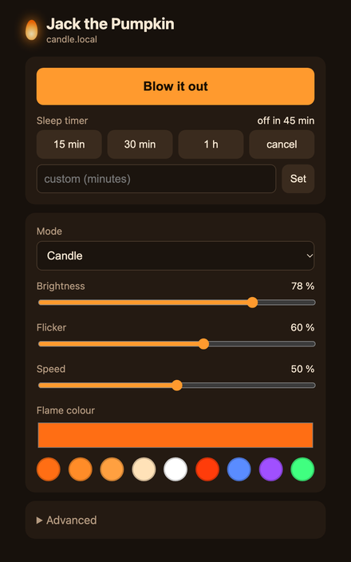
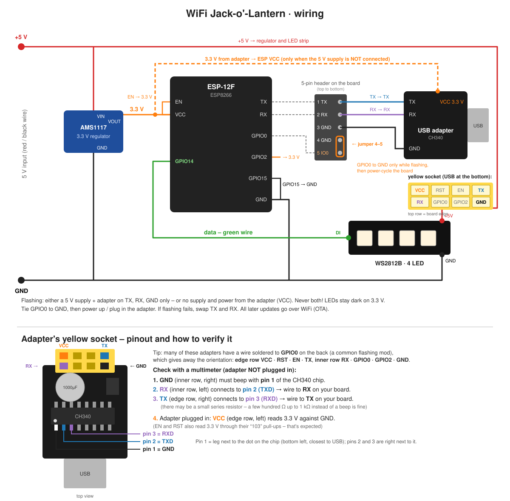
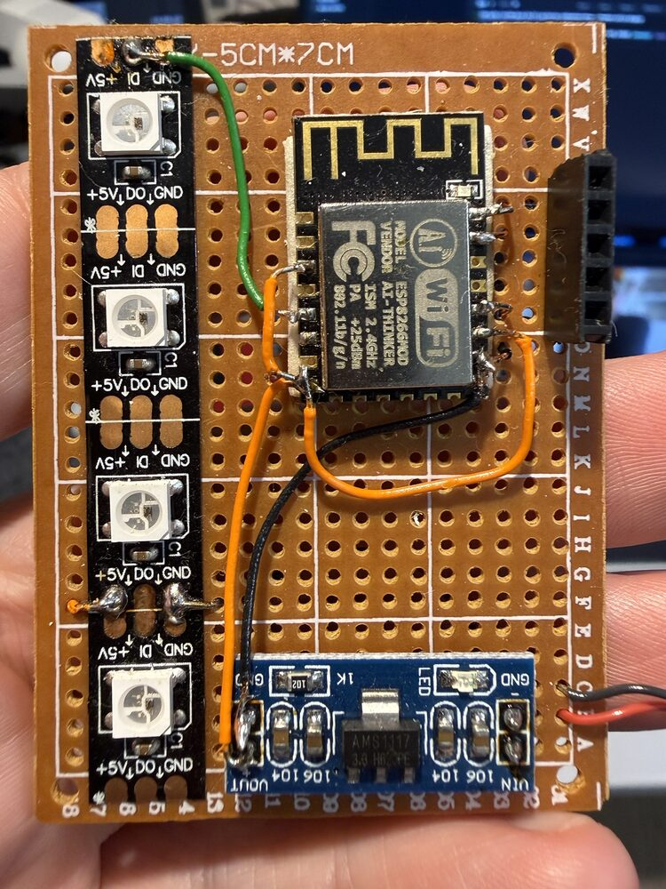
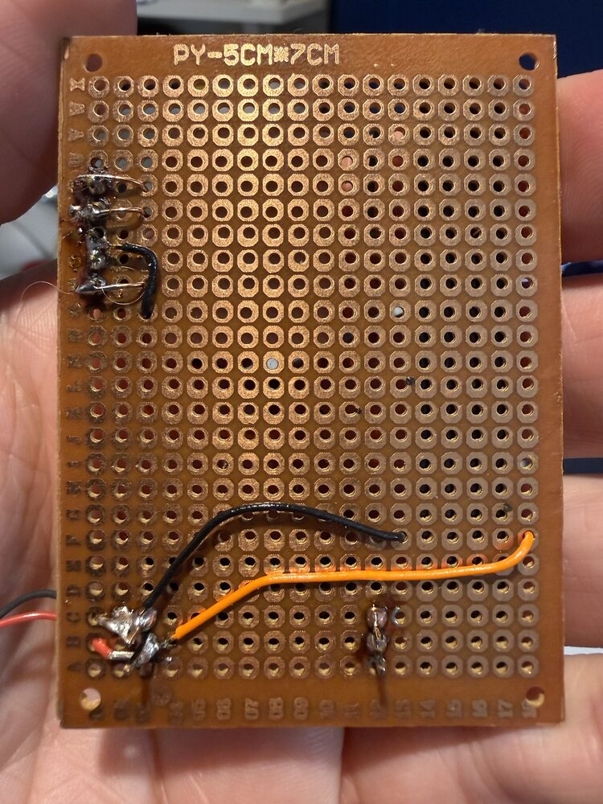
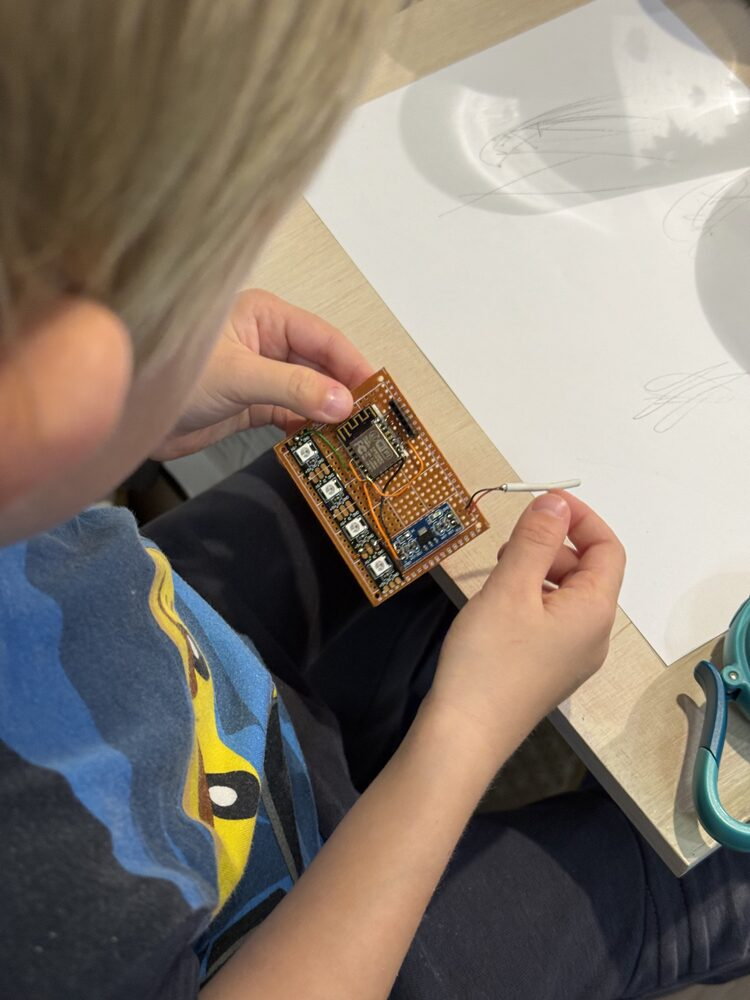
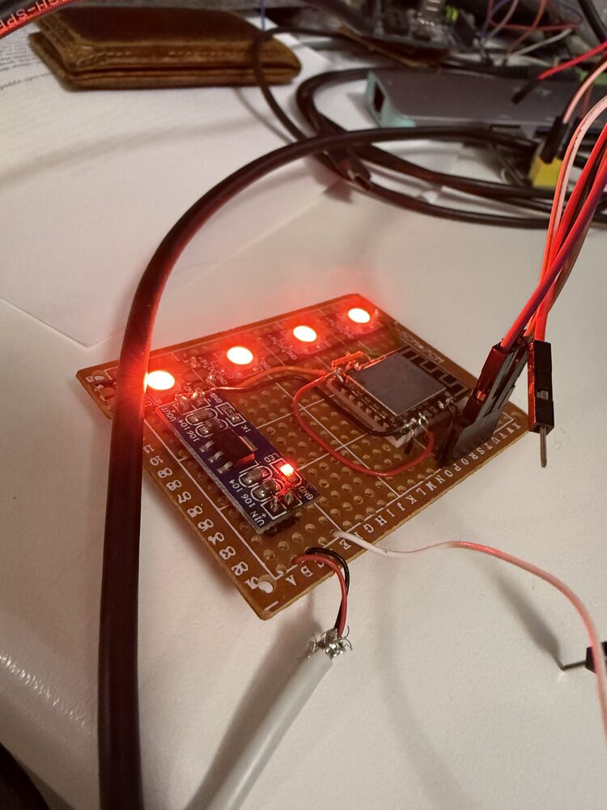
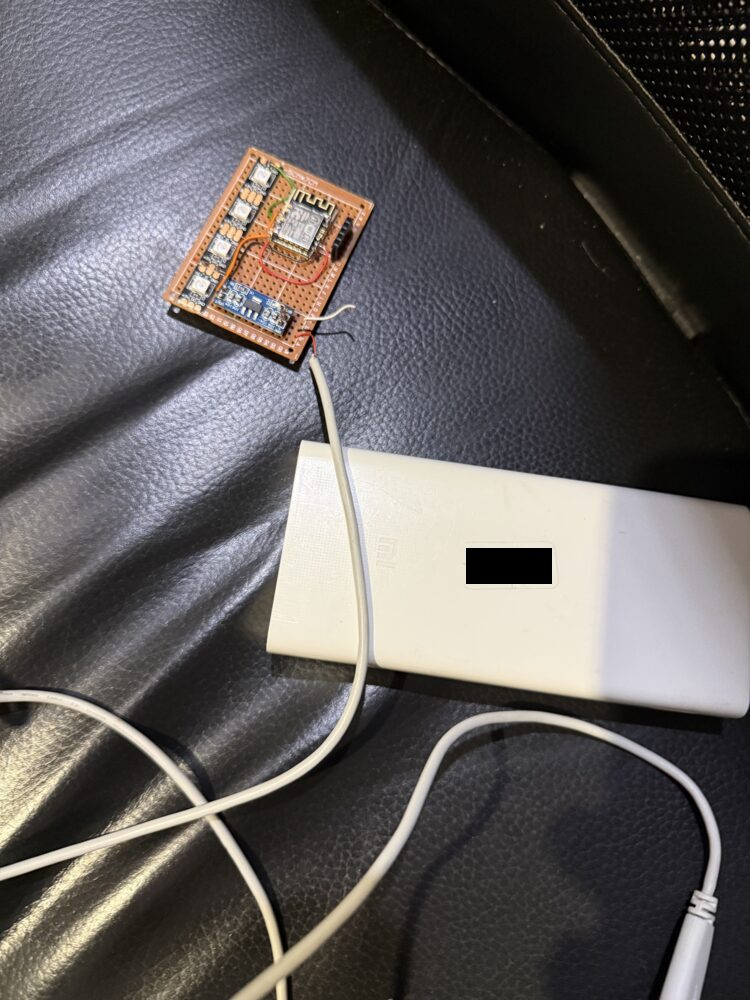
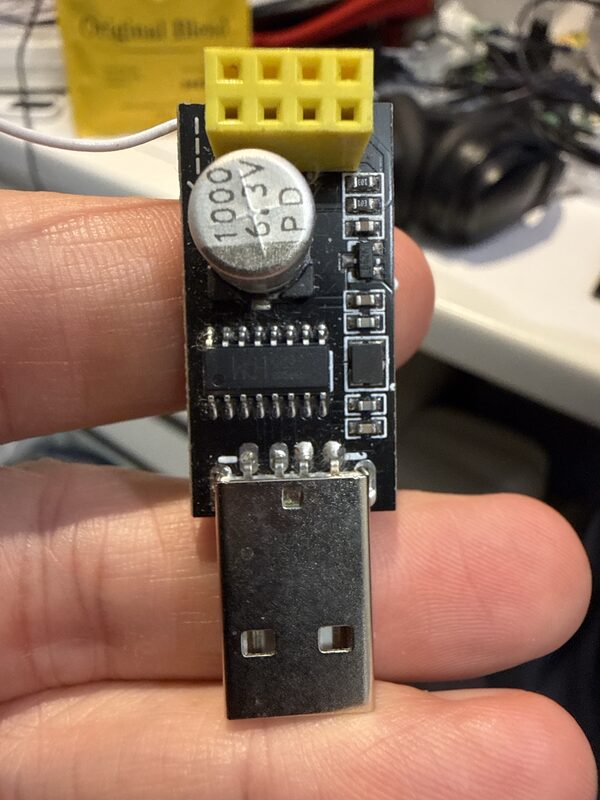
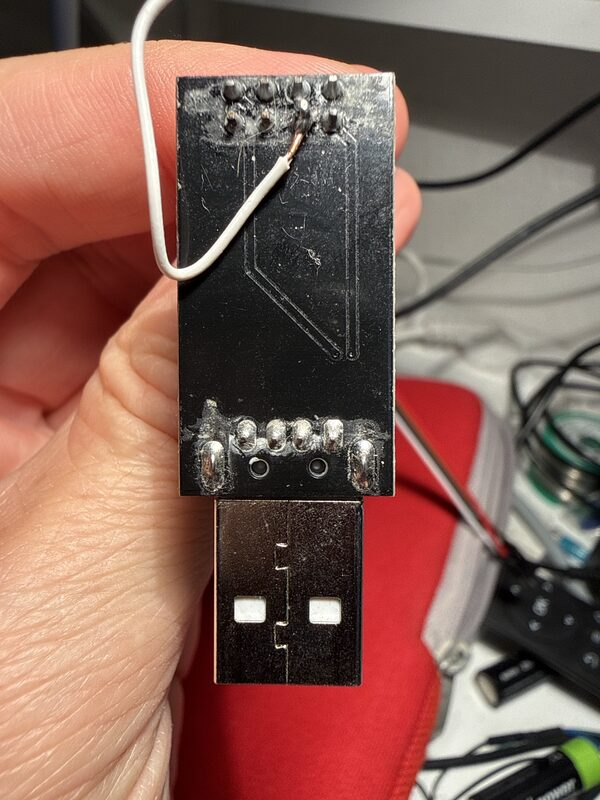

# 🎃 WiFi Jack-o'-Lantern

**A flickering "candle" for your carved pumpkin that you control from your phone.**
One ESP8266, four NeoPixels, an evening of soldering. No soot, no burnt lid, no fire brigade.

<p align="center">
  
</p>

<p align="center">
  <a href="https://platformio.org"></a>
  
  
  
  <a href="LICENSE"></a>
</p>

Real candles in pumpkins are a bit of a scam: they cook the pumpkin from the inside, blacken the lid and die
right when the trick-or-treaters show up. This one flickers like a real flame, runs all night from a USB power
bank, and you can switch it from *cosy candle* to *full-on bonfire* from the sofa. 🛋️🔥

▶️ [Watch the full video](docs/images/pumpkin.mp4)

---

## ✨ What it does

- 🕯️ **Realistic candle flicker** – every LED has its own little flame, plus the occasional "draught" that makes
  them all dip together. When the flame dims it also gets redder, just like a real one.
- 🔥 **Three moods** – *Candle*, *Fire (wilder)* and *Steady light*.
- 📱 **Web UI on your phone** – brightness, flicker, speed, colour (incl. warm white & spooky green/purple).
- ⏲️ **Sleep timer** – 15 min, 30 min, 1 h or any custom value. Goes out by itself with a smooth fade.
- ⏰ **Set-and-forget schedule** – "on at 17:00, off at 22:00", with internet time and proper time zones/DST.
  Put it on the porch or in the kids' room and forget about it.
- 🔌 **Works like a lamp** – plugging it in always lights it with the last settings, even with no internet.
  Once the clock syncs it simply follows the next on/off step.
- 📶 **No hard-coded WiFi** – first boot opens a hotspot, you pick your network on your phone. You can switch
  networks later from the web UI.
- 🏷️ **Name it** – every pumpkin gets its own name and address (`jack.local`, `porch.local`, …), so a whole
  pumpkin army can live on one network.
- 🚀 **Over-the-air updates** – flash once with a cable, then never again.
- 💾 **Remembers everything** across power cuts (and only writes to flash when something actually changed).

<p align="center">
  
</p>

## 🛒 Shopping list (~ $8)

| Part | Notes |
|---|---|
| ESP8266 **ESP-12F** module (or ESP-12E) | the brain + WiFi |
| **WS2812B** LED strip, 4 LEDs | cut 4 pixels off any 5 V NeoPixel strip |
| **AMS1117-3.3** regulator module | 5 V → 3.3 V for the ESP |
| 5 × 7 cm perfboard, some wire | |
| 5-pin header + 1 jumper | for flashing |
| USB-to-serial adapter, **3.3 V** | e.g. the cheap CH340 "ESP-01 adapter" – only needed once |
| 5 V USB power bank or phone charger | a 10 000 mAh bank easily lasts the whole night |

> 💡 **Lazy mode:** got a **Wemos D1 mini** or **NodeMCU**? Skip the regulator, header and USB adapter – they're
> already on the board. Connect LED `+5V` → `5V`, `GND` → `G`, `DI` → `D5` (GPIO14) and flash it over USB.
> Literally a 10-minute build.

## 🔌 Wiring

<p align="center">
  
</p>

| From | To | Why |
|---|---|---|
| 5 V input (+) | AMS1117 `VIN` **and** LED strip `+5V` | LEDs want 5 V |
| 5 V input (−) | AMS1117 `GND`, ESP `GND`, LED `GND` | common ground |
| AMS1117 `VOUT` | ESP `VCC` | 3.3 V for the ESP |
| ESP `EN`, `GPIO2` | 3.3 V | boot straps |
| ESP `GPIO15` | GND | boot strap |
| ESP `GPIO14` | LED strip `DI` | data (green wire) |
| ESP `TX`, `RX`, `GPIO0`, `GND` | 5-pin header | for flashing |

The 5-pin header, top to bottom: **1 TX · 2 RX · 3 GND · 4 GND · 5 GPIO0** – so a single jumper across pins 4–5
puts the ESP into flashing mode. Neat.

| Board front | Board back |
|---|---|
|  |  |

## 🧪 Build log

| The junior engineer at work | First light! | Ready to go into the pumpkin |
|---|---|---|
|  |  |  |

## ⚡ Flashing

You need [PlatformIO](https://platformio.org) (VS Code extension or CLI). Everything else downloads itself.

### First time – over a cable

1. Put the **jumper on header pins 4–5** (GPIO0 → GND).
2. Wire the USB adapter: adapter `TX` → header `RX`, adapter `RX` → header `TX`, `GND` → `GND`.
   (On the CH340 ESP-01 adapter the socket is already crossed – there it's `TX`→`TX`, `RX`→`RX`.
   The diagram has a section on finding the right holes.)

   | CH340 adapter, top | …and bottom (white wire = GPIO0 mod) |
   |---|---|
   |  |  |
3. **Power the board from 5 V** (power bank / charger on the red-black wires) and plug in the adapter.
4. Flash:

   ```bash
   pio run -e serial -t upload
   ```

5. Remove the jumper and power-cycle the board. 🎉

### Every time after that – over WiFi

```bash
pio run -e ota -t upload                              # default address candle.local
pio run -e ota -t upload --upload-port jack.local     # a pumpkin you renamed
```

The OTA password is `candle` – change it in `src/main.cpp` **and** `platformio.ini` before you put your pumpkin
on the porch.

## 📶 First start

1. Power it up. With no WiFi saved, the pumpkin opens a hotspot called **`candle-setup`**.
2. Join it from your phone – a setup page pops up. Pick your WiFi, type the password.
3. Back on your home WiFi, open **http://candle.local**. Light it up. 🎃
   (Some Android phones don't do `.local` names – use the pumpkin's IP from your router instead.)

Moved house? *Advanced → WiFi → Scan networks* switches networks from the web UI. If the new network doesn't work
out, the pumpkin falls back to the `…-setup` hotspot, so you can never lock yourself out.

## 🤖 HTTP API (a.k.a. Halloween home automation)

Everything the web UI does is a simple GET on `/api` – handy for Home Assistant, Shortcuts or a cron job that
lights the pumpkin at sunset.

```bash
curl "http://candle.local/api"                              # current state as JSON
curl "http://candle.local/api?on=1"                         # light it
curl "http://candle.local/api?toggle=1"
curl "http://candle.local/api?mode=1&flicker=90&speed=80"   # bonfire mode
curl "http://candle.local/api?color=%2340ff80"              # witchy green
curl "http://candle.local/api?timer=120"                    # off in 2 hours
```

| Parameter | Values |
|---|---|
| `on` / `toggle` | `0`/`1` / any |
| `brightness` | 0–255 |
| `flicker`, `speed` | 0–100 |
| `mode` | `0` candle, `1` fire, `2` steady |
| `color` | `#rrggbb` (URL-encoded `%23rrggbb`) |
| `timer` | minutes, `0` cancels |
| `sched`, `schedOn`, `schedOff` | `0`/`1`, `HH:MM`, `HH:MM` |
| `tz` | POSIX time zone, e.g. `CET-1CEST,M3.5.0,M10.5.0/3` |
| `name`, `hostname` | device name / `hostname`.local (changing the hostname restarts it) |
| `ledCount`, `pin` | strip length (1–60) / data GPIO (2, 4, 5, 12, 13, 14) |

## 🕯️ How the flicker works

Each LED chases a random brightness target that is *usually* close to full and *sometimes* drops deep
(`1 − intensity · r³`), with exponential smoothing so it never jumps. 60 % of each LED follows a shared
"common flame", 40 % is its own, which makes the light move around inside the pumpkin instead of blinking.
Every now and then a "gust" dims everything at once. Green and blue fall off faster than red as the flame dims
(`g · v^1.6`, `b · v^2.5`), so dips turn deep orange – and a gamma curve keeps it all looking natural to the eye.

All of it lives in `renderFrame()` in [`src/main.cpp`](src/main.cpp), ~40 lines. Tweak away.

## ⏰ The schedule, in plain words

- **Power on** (plugged in) → lights up with the last settings. No clock needed.
- **Clock synced** (NTP, a few seconds after joining WiFi) → it waits for the *next* step: at *On at* it lights,
  at *Off at* it goes out. Overnight ranges like 18:00 → 06:00 work too.
- **Restarts over WiFi** (updates, renaming) keep whatever state it was in.
- You can still switch it manually any time – the schedule just takes over again at the next step.

## 🔐 Security note

This is a cosy LAN gadget, not Fort Knox: the web UI has no login, and the OTA password is a compile-time default.
Change `OTA_PASSWORD` (and `upload_flags`) before deploying, keep it on your home network and never port-forward it
to the internet. Guests on your WiFi *will* be able to make your pumpkin go disco. 🪩

## 👻 Lessons learned the spooky way

- **"Failed to connect to ESP8266"** for an hour? Check the **power** first. The 3.3 V pin of an Arduino Uno can't
  feed an ESP8266 (it needs 300+ mA peaks). Ours sat there completely silent until we fed the board proper 5 V.
  A **flickering power LED on the regulator** is the tell-tale sign of a brown-out.
- To test a USB-serial adapter, short its `TX` and `RX` and send something – if it comes back, the adapter is fine.
- Pumpkins are wet inside. Put the board in a small zip bag or a jam jar and keep the power bank outside.

## 📁 Project layout

```
├── platformio.ini       # build + upload config (serial & OTA)
├── src/main.cpp         # flame effect, WiFi, web server, OTA
├── src/page.h           # the web UI (single HTML page)
└── docs/                # wiring diagram, photos, GIF
```

## 📜 License

[MIT](LICENSE) – carve it, fork it, light it. If you build one, open an issue with a photo of your pumpkin! 🎃
